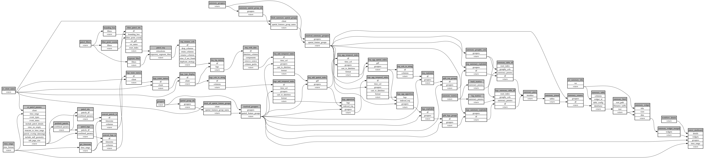

```
# AUTOGENERATED BY ECOSCOPE-WORKFLOWS; see fingerprint in README.md for details

```

```yaml
# fingerprint:
artifacts_sha256_basic: fc3fad309c1bf2ceb1afad6cf87aeeb685b11fdcd2f32ebf04f3370775e05116
artifacts_sha256_strict: caa7a03a1a02d8a96643b809b98f256ddd71573a579055e67dfc4bf92c33ae2b
installed_requirements:
- channel: https://repo.prefix.dev/ecoscope-workflows/
  name: ecoscope-platform
  version: {version: ==2.30.1}
- channel: conda-forge
  name: pydeck
  version: {version: ==0.9.2}
params_sha256: 5d84ed912ad0157aba629db3084ac31848b403503c7fcee1aab58c8db8c88fae
spec_sha256: 10821f83cee1e3dd23e281427203834422ab7356753d97b1f279a7352ed7a46f

```

# ecoscope-workflows-patrol-effort-table-workflow


