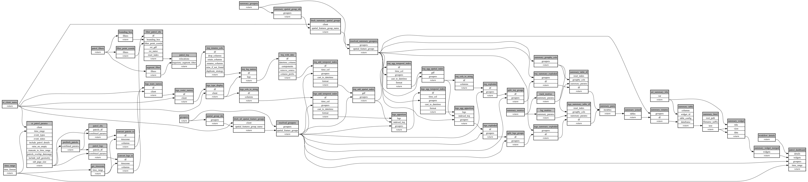

```
# AUTOGENERATED BY ECOSCOPE-WORKFLOWS; see fingerprint in README.md for details

```

```yaml
# fingerprint:
artifacts_sha256_basic: 66c5b737209ee4e0b89f17355ca4ff48ddc5aa184ea331b0f914b34a17f2c5f7
artifacts_sha256_strict: db7ec3f491c43a110b1a47a6fdddf405574a468645d87400a864d3692a25e757
installed_requirements:
- channel: https://repo.prefix.dev/ecoscope-workflows/
  name: ecoscope-platform
  version: {version: ==2.27.1}
- channel: conda-forge
  name: pydeck
  version: {version: ==0.9.2}
params_sha256: 5d84ed912ad0157aba629db3084ac31848b403503c7fcee1aab58c8db8c88fae
spec_sha256: 2be6427efe53f55f6b568c4b381d624efd4a9ae6e7f9086b022189ae26b7627d

```

# ecoscope-workflows-patrol-effort-table-workflow


