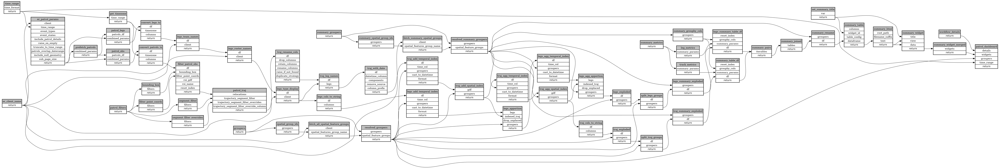

```
# AUTOGENERATED BY ECOSCOPE-WORKFLOWS; see fingerprint in README.md for details

```

```yaml
# fingerprint:
artifacts_sha256_basic: ac7e3bdbf508ad6945c99beaac4b342b3865d8c04299fc156374c897e956d1a0
artifacts_sha256_strict: 7992a820de02e7c90d98744a450cf07adae4f97db6c2eccfc61089e40a3ac658
installed_requirements:
- channel: https://repo.prefix.dev/ecoscope-workflows/
  name: ecoscope-platform
  version: {version: ==2.39.4}
- channel: conda-forge
  name: pydeck
  version: {version: ==0.9.2}
params_sha256: f0b1ad0d321620412a476b79b2d58537f37b7335725f698280c69100ce825c6d
spec_sha256: 350e9566cdf5f1cac64766d7ebc39389059cbb8325b2c0703c9955ffc1e7d80e

```

# ecoscope-workflows-patrol-effort-table-workflow


